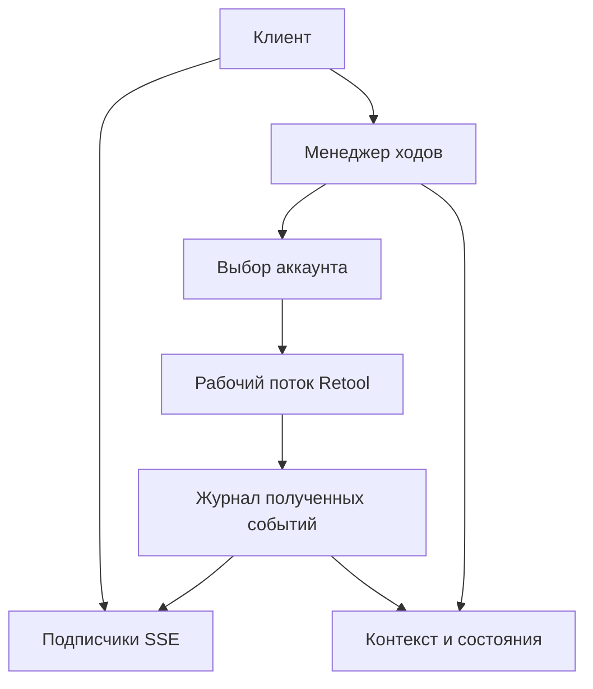

# Proxi: авторизация пула и обрывы долгих генераций

Дата исследования: 2 ноября 2026. Проверенный `main`: [`188fd760307c2275521f71e6f47fd49fe23e7fa8`](https://github.com/newnout6-a11y/proxi/commit/188fd760307c2275521f71e6f47fd49fe23e7fa8).

**Обновление 3 ноября:** изоляция аккаунтов, транзакционная запись конфигурации,
выбор маршрута, повторный keepwarm и строгая политика effort реализованы.
[Проверки и живые результаты](auth-effort-fixes-2026-11-03.md).
Разделы 1–5 ниже описывают исходный commit и исходный проект изменений;
job/replay, долговечный контекст и независимые таймеры остаются отдельной работой.

Записка разбирает четыре связанные задачи: аккаунты ломают друг другу авторизацию при refresh; поток обрывается во время скрытого thinking; повторный запрос теряет дешевое чтение кэша; запрошенный effort отличается от фактически выбранного.

Главный приоритет пула — изоляция учетных данных при обновлении. Улучшение балансировки идет после исправления auth-state. Ниже отдельно обозначены подтвержденные дефекты, исторические live-наблюдения и проект изменений. Записка и диагностические проверки не изменяют runtime Proxi.

## 1. Авторизация: почему один аккаунт может ломать другой

### Подтвержденные сценарии

В [`config.reload_auth()`](https://github.com/newnout6-a11y/proxi/blob/188fd760307c2275521f71e6f47fd49fe23e7fa8/config.py#L157) запись `accounts[]` выбирается по первому совпадению `page_uuid`. Затем проверяется `base` и копируются cookie/xsrf. [`Refresher.refresh()`](https://github.com/newnout6-a11y/proxi/blob/188fd760307c2275521f71e6f47fd49fe23e7fa8/upstream_refresh.py#L56) вызывает reload до сетевого refresh.

`page_uuid` указывает страницу, а не пользователя или auth-сессию. Два пользователя одной организации могут обращаться к одной странице: даже пара host+page не различает их аккаунты.

| Условия | Воспроизведенное поведение | Последствие |
|---|---|---|
| Одинаковые host и page_uuid, разные cookies A/B | При refresh B загружает cookies/xsrf A из файла; сетевого обращения нет | Реальная подмена авторизации B в памяти |
| Одинаковый page_uuid, разные host | После ротации B обновляет собственную запись и первую совпавшую запись A в общем списке; сохранение дает ValueError из-за origin | Повреждение общего account record и несохраненная ротация |
| Разные аккаунты одновременно сохраняют ротации | Обе записи возвращают успех, но остается только одна обновленная пара | На диске сохраняются устаревшие credentials одного аккаунта |
| Разные page_uuid, последовательный refresh | Контроль: обновляется B; A не меняется в памяти и файле | Подтверждает границы воспроизведения |

Поиск первой совпавшей страницы есть также в [`persist_auth()`](https://github.com/newnout6-a11y/proxi/blob/188fd760307c2275521f71e6f47fd49fe23e7fa8/config.py#L101) и при обновлении общего `accounts[]` в refresher. Это разные проявления неправильного сопоставления учетной записи.

Атомарный `os.replace` защищает целостность отдельного JSON-файла, но не сериализует два цикла read–modify–write. Каждый refresher имеет собственный lock; два аккаунта могут прочитать одну старую версию и затереть изменения друг друга. Блокировки всех refresher при сохранении настроек администратора из PR #14 не устраняют гонку между двумя обычными refresh.

**Границы вывода.** Эти дефекты подтверждены локальными тестами с синтетическими credentials. Совпадение полей в production-конфигурации не установлено. Подмена credentials не доказывает серверный отзыв сессии Retool. Повреждение общего account record не означает немедленную смену снимка cookies в уже созданном независимом Backend A. Потерянная запись на диск и мгновенный сетевой обрыв тоже не эквивалентны.

### Как исправить auth-state

1. Ввести стабильный уникальный `account_id`, независимый от page_uuid. Связать его с проверенной учетной записью и tenant. Не считать один host идентификатором пользователя.
2. Во всех путях reload/persist/refresh/admin выбирать только точный account_id с проверкой tenant. Если запись не найдена, не подхватывать глобальные credentials другого аккаунта. Неоднозначную миграцию старого конфига отклонять с понятной ошибкой.
3. Обновлять ровно соответствующую запись. Убрать повторный поиск по странице после обновления `_account_ref`.
4. Защитить весь read–check–merge–replace общим storage lock либо транзакцией. Все писатели, включая admin, используют один механизм. Для нескольких процессов нужен межпроцессный lock или транзакционное хранилище, например SQLite. Сетевой refresh не должен удерживать общий lock файла.
5. Хранить согласованный версионированный снимок cookie+xsrf+account_id. Запрос берет одну версию; refresh публикует новую. Неудача записи видна отдельно от успеха сетевого обновления и не теряется в health.
6. Назначить одного координатора ротации на настоящую auth-сессию. При нескольких процессах нужны координация и проверка версии; process-local lock недостаточен.

Отдельно проверить, не являются ли записи пула копиями одной реальной сессии. Если сервер применяет одноразовую ротацию refresh token, независимые владельцы такой сессии могут инвалидировать друг друга. **Точная политика Retool здесь не измерена; это гипотеза, а не установленная причина.** Исправление локальных ключей не заменяет независимые сессии либо общий координатор для действительно общей сессии.

Для диагностики достаточно account_id, tenant, версии auth-state, времени refresh и безопасного идентификатора сессии. Не требуется записывать содержимое cookies в журнал.

### Балансировка после исправления авторизации

Текущий [`SessionPool._next_backend()`](https://github.com/newnout6-a11y/proxi/blob/188fd760307c2275521f71e6f47fd49fe23e7fa8/session.py#L866) выбирает минимум: сохраненная беседа имеет вес 1, активный lease — 2, равенство разрешает round-robin. Выбор не проверяет нужный ресурс, доступность модели, auth-state, бюджет и cooldown. (устарело: с 3 ноября выбор отбирает аккаунты с маршрутом нужной модели и исключает аккаунты `exhausted`/`auth_dead`; `min_account_balance` работает как резерв failover — одиночный аккаунт ниже порога обслуживается, пока баланс > 0; нагрузочный выбор среди подходящих прежний.)

| Компонент | Ответственность |
|---|---|
| AccountRegistry / AccountRuntime | Идентичность, маршруты, auth-state, активные запросы, cooldown и емкость аккаунта |
| ConversationRegistry | Основной аккаунт беседы, версия контекста, текущий основной ход |
| Scheduler | Сначала отбор подходящих аккаунтов, затем нагрузка, очередь и преимущество совместимого кэша |
| UsageLedger | Фактические расходы ходов, повторов и прогревов с учетом области бюджета |
| WarmScheduler | Один совместимый прогрев одновременно, ограничение срока и расходов |

Существующую беседу оставлять на подходящем исправном аккаунте. Параллельный служебный запрос может использовать отдельное соединение того же аккаунта в пределах его емкости. Смена организации только из-за занятости не должна быть неявной. Основной ход, заголовок, суммаризация и самостоятельный подагент требуют явных ролей и правил очереди.

Сейчас параллельный запрос той же беседы способен получить дочернюю сессию на другом backend. Копирование `_cached_head` переносит текст, но не удаленный кэш. Настройки аккаунта также наследуются из global cfg: если tenant B не переопределил provider resource, ему может достаться UUID tenant A. Разрешение ресурса после acquire не проверяет такое наследование. (устарело: параллельный запрос беседы остаётся на её аккаунте, пока тот доступен и имеет маршрут к модели; ресурсы другого tenant не наследуются из глобальных настроек.)

В [`Runtime`](https://github.com/newnout6-a11y/proxi/blob/188fd760307c2275521f71e6f47fd49fe23e7fa8/proxy.py#L60) один CreditsManager привязан к первому backend. Его баланс нельзя выдавать за остаток каждого аккаунта. (устарело: у каждого аккаунта свой CreditsManager; `/v1/balance`, `/v1/usage`, `/health` и строка `[balance]` в консоли учитывают все аккаунты.) Несколько пользователей одной организации могут расходовать общий пул Retool credits; также существуют ограничения пользователей, групп и моделей. Область ограничения нужно учитывать, а не считать каждую cookie независимым бюджетом. Источники: [Retool pricing](https://retool.com/pricing), [spend controls](https://docs.retool.com/org-users/guides/monitoring/spend-controls).

| Ошибка | Политика |
|---|---|
| 401/403 | Один refresh на соответствующую auth-сессию; затем повтор с новой версией. При неуспехе — auth_failed |
| 429 | Retry-After и cooldown соответствующего account/org/model/provider; ограниченная очередь |
| Недостаток credits | Исключить исчерпанный бюджет; не повторять бесконечно |
| 400/422 запроса | Понятная ошибка; смена аккаунта обычно не исправляет тело |
| Временный 5xx/сеть | Ограниченные повторы с задержкой; не объявлять весь аккаунт мертвым после одного сбоя |
| Обрыв после текста/tool calls | Сохранить полученное, отметить incomplete; не склеивать молча с новой генерацией |

## 2. Обрыв upstream во время скрытого thinking

### Что установлено по PR

[PR #13](https://github.com/newnout6-a11y/proxi/pull/13) описывает дорогую повторную запись контекста после MAX-ходов длиной 310–325 секунд. Это проблема цены следующего запроса после истечения кэша, а не доказательство смерти активной генерации.

[PR #14](https://github.com/newnout6-a11y/proxi/pull/14) исправил настоящий дефект завершения: отсутствие `end_of_stream` раньше могло выглядеть как успешный `stop`.

В одном [разобранном наборе логов](https://github.com/newnout6-a11y/proxi/blob/188fd760307c2275521f71e6f47fd49fe23e7fa8/docs/review-and-merge-2026-11-01.md#L43) кажущийся обрыв оказался перемешанными строками основного и параллельного короткого запросов. Это объяснение конкретной трассы; оно не исключает других реальных обрывов.

### Какие таймеры нужно различать

В [`direct._stream_body()`](https://github.com/newnout6-a11y/proxi/blob/188fd760307c2275521f71e6f47fd49fe23e7fa8/direct.py#L824) `turn_timeout` передается в `urllib.request.urlopen(timeout=...)`: это timeout блокирующих операций сокета, не строгий deadline всего хода. `recv_timeout` и `upstream_timeout` не управляют чтением этого direct-пути. Семантика: [Python urllib](https://docs.python.org/3.12/library/urllib.request.html).

Локальный HTTP-сервер отправлял начало thinking и затем молчал 0.5 секунды: при socket timeout 0.15 секунды возник `TimeoutError`. С пустой строкой от upstream каждые 0.05 секунды тот же ход завершился. Это проверка механизма на localhost, не измерение лимита Retool.

Локальная строка `Model is actively reasoning...` — таймер после thinking_start. Она не подтверждает новые байты upstream. SSE-комментарии Proxi поддерживают клиентское соединение; отдельный keepwarm-запрос касается кэша. Ни то ни другое не является heartbeat исходного upstream-потока и не обходит его внешний hard deadline.

Отдельно [`proxy._pump()`](https://github.com/newnout6-a11y/proxi/blob/188fd760307c2275521f71e6f47fd49fe23e7fa8/proxy.py) (метод `_pump` в `proxy.py`; прежний якорь `#L497` указывал на другую строку) отменяет upstream при исчезновении клиента. Это дополнительный механизм потери работающей генерации, но не объяснение подтвержденного обрыва на стороне upstream.

Нужны независимые `connect_timeout`, `upstream_read_idle_timeout`, `turn_deadline` и `subscriber_write_timeout`. Значения задаются из допустимой длительности задачи и измерений. Увеличение локального таймера не отменяет ограничение сервера выше по цепочке.

Для каждого завершения фиксировать turn/request/attempt/account/model/effective effort, времена headers/первого события/последнего байта/первого текста, последний event, число байтов, наличие end_of_stream и точную причину: EOF, timeout, reset, HTTP error, client cancel или собственный deadline. Cookies не нужны. Повторяемость на 300/600/900 секундах указывает на таймер, но не устанавливает узел без трассы. Ограничения Retool Workflows/AI Actions нельзя переносить на этот streaming route автоматически.

### Можно ли включить видимый thinking в Retool

В прямом Claude API читаемая сводка включается так:

```json
{"thinking":{"type":"adaptive","display":"summarized"}}
```

У Opus 5.5 и ряда новых моделей по умолчанию используется `omitted`. `summarized` возвращает провайдерскую сводку, а не raw chain of thought. Источники: [thinking display](https://platform.claude.com/docs/en/build-with-claude/thinking#controlling-thinking-display), [empty thinking troubleshooting](https://platform.claude.com/docs/en/build-with-claude/thinking-troubleshooting#the-thinking-field-is-empty-in-the-response).

В проекте уже есть [исследование от 30 октября](https://github.com/newnout6-a11y/proxi/blob/188fd760307c2275521f71e6f47fd49fe23e7fa8/docs/reasoning-visibility.md), основанное на тогдашних живых пробах: `copilotStreamGPT` игнорировал `thinking`, `thinkingDisplay`, `reasoningSummary`, `includeThinking`, `providerOptions` и другие способы передать этот контроль. Неизвестный reasoningEffort давал 422, бессмысленный thinking.type — 200 без эффекта. Текст для Opus 5.5 не появился ни через direct/WS, ни в истории треда.

В текущем Proxi `thinking.display` управляет только локальным показом уже полученного текста (`validate._show_thinking`). `direct.build_body()` не передает провайдерский объект thinking. Следовательно, включение `show_thinking` само по себе не заставит Retool запросить summarized у Anthropic.

В просмотренной официальной документации Settings > AI и конфигурации AI resource подтвержденного переключателя thinking display не найдено. Наличие недокументированного либо планозависимого флага в конкретном аккаунте не проверено: авторизованная вкладка Retool была недоступна. Повторно прочитать публичный CDN-бандл веб-инструмент не смог, поэтому свежая проверка его схемы не заявляется.

Для BYOK Retool [документирует AI proxy через Base URL ресурса](https://docs.retool.com/build/apps/guides/configuration?plan=team). Передача summarized через такой прокси требует отдельной проверки; это не подтвержденная настройка Retool-managed credits.

Видимые сводки позволили бы сохранять поступившие фрагменты и, если передаются сразу, уменьшить паузы без входящих байтов. Они не гарантируют устранения server deadline и не обеспечивают resume погибшего скрытого вычисления. Подпись не превращается в читаемый текст локальным декодированием.

### Что реально можно восстанавливать

| Ситуация | Возможность |
|---|---|
| Исчез SSE-подписчик, исходный upstream жив | Переподключить клиента к тому же выполняющемуся ходу |
| Получена часть текста, upstream утрачен | Сохранить текст и начать новую генерацию с продолжением |
| Обрыв внутри скрытого thinking | В текущем маршруте нет механизма продолжить прежнее внутреннее вычисление |
| Рестарт Proxi без долговечной задачи upstream | Вернуть записанные события; потерянное выполнение пометить interrupted/orphaned |

Официальная [Claude streaming recovery](https://platform.claude.com/docs/en/build-with-claude/streaming#error-recovery) описывает новую генерацию по полученному тексту; для новых моделей — отдельный user-запрос продолжить. Частично полученные thinking/tool-use блоки таким способом не восстанавливаются. Входной prompt cache может удешевить повторный вход, но не возвращает время потерянного размышления.

Для переподключения клиента нужен управляемый ход, отделенный от подписчика:



Предлагаемый контракт: создание хода с явным idempotency key; получение состояния по turn_id; replay событий после event ID; отдельная отмена. Тот же idempotency key с другим телом дает конфликт; один хэш текста не должен запрещать намеренно одинаковые запросы.

Сохранять account/model/effective effort, prompt fingerprint, attempt ID, времена, номера событий, полученный текст, завершенные tool calls и результаты. Оборванные JSON-аргументы не исполнять. Повтор доставки call_id не должен повторять побочное действие: нужен подтвержденный статус/результат инструмента.

Job-режим требует поддержки клиентом или адаптером. Некоторые IDE используют разрыв соединения как Stop; нельзя молча заменить это продолжением платной генерации. Нужны явная отмена, deadline, ограничение времени без подписчиков и бюджета.

Локальный `direct-...` — не ID долговечной задачи Retool. После рестарта Proxi обычное HTTP-соединение утрачено; запись running не делает его живым. Для восстановления самого вычисления требуется поддерживаемая upstream долговечная задача/resume API, которой в изученном маршруте не установлено.

## 3. Локальный контекст и удаленный кэш

### Что сохранять локально

| Данные | Польза |
|---|---|
| Точные system/tools/messages и порядок блоков | Повторить стабильный префикс после рестарта |
| Account/org/model/resource/cache key и совместимые настройки | Вернуться в ту же область кэша, если она еще жива |
| Полученный текст и tool results | Восстановить историю и видимую часть результата |
| Последние подтвержденные cache read/write | Планировать прогрев и объяснять расходы; это не гарантия наличия entry |
| Готовый ответ явно идемпотентного запроса | Повторно выдать тот же сохраненный результат |

Сейчас `_warm_body` живет в памяти сессии; восстановления с диска нет. Snapshot полезен, но локальный JSON не содержит удаленного KV-state. Для дешевого чтения нужны совместимый префикс, параметры и область кэша, а сама entry должна еще существовать. После истечения удаленного кэша сохраненный prompt придется обработать заново; изученный маршрут не предоставляет экспорта/обратной загрузки его KV-state.

Prompt cache, готовые ответы и незавершенное размышление — разные состояния. Snapshot должен иметь версию формата, атомарную запись, ограниченный срок хранения и права доступа к пользовательскому контексту. Восстановленное running без живого worker отмечается interrupted.

### Предел существующего keepwarm

По семантике Claude TTL считается от начала запроса, коснувшегося префикса; чтение обновляет срок. У прямого API есть опция 1h. В исследованном Retool-теле есть `cache: boolean`, но явного TTL нет; PR #13 документирует то же ограничение схемы. Возможность провайдера не означает ее доступность через посредника. Источник: [prompt caching](https://platform.claude.com/docs/en/build-with-claude/prompt-caching).

В [`direct._keepwarm()`](https://github.com/newnout6-a11y/proxi/blob/188fd760307c2275521f71e6f47fd49fe23e7fa8/direct.py#L633) during-turn ping срабатывает один раз на +200 секундах. После `_turn_pinged=True` он не повторяется; обычные idle-пинги пропускаются, пока `_busy=True`. Виртуальный ход длиной 900 секунд подтвердил единственное касание: `[200.0]`. (устарело: после исправлений 3 ноября during-turn ping повторяется каждые `min(cache_keepwarm_seconds, 240)` с от начала предыдущего ping; первый — на `cache_keepwarm_turn_offset`, ограниченном диапазоном [30, 285] с; после 5 неудач подряд keepwarm останавливается.)

| Время от старта | Расчет при успешном чтении и TTL 5 минут |
|---|---|
| 0 сек | Основной запрос касается префикса |
| 200 сек | Единственный during-turn ping |
| Около 500 сек | Заканчивается гарантируемое окно после этого касания, если других не было |
| 900 сек | Генерация может продолжаться, но код не делал следующих касаний |

Это предел гарантируемого покрытия, не доказательство удаления entry ровно на 500-й секунде: удаленный сервис может хранить ее дольше. Истечение prompt cache само по себе не должно обрывать активную генерацию.

### Как изменить прогрев

- Планировать очередное касание относительно старта последнего подтвержденного чтения/записи, с запасом до TTL. Не отсчитывать срок от конца длинного ping.
- Продлевать по необходимости во время всего активного хода; между ходами — только в пределах срока простоя и бюджета.
- Объединять одинаковые прогревы по account/namespace/model/совместимому префиксу. Учитывать их в емкости аккаунта и не вытеснять пользовательские запросы.
- Проверять `promptTokensReadFromCache`, `promptTokensWrittenToCache`, `creditsUsed`, завершение и ошибку. HTTP 200 не доказывает дешевое чтение; отсутствующая телеметрия означает unknown.
- При ошибках использовать backoff и общую auth/429-политику. Не объявлять TTL продленным без подтверждения и не запускать плотные повторы.
- Учитывать стоимость всех warm/retry операций в ledger; различать фактические списания и оценки.

`_ping()` заменяет effort основного запроса на low (устарело: `_ping()` сохраняет точные настройки запроса, включая effort). В исторической трассе PR #14 это давало дешевые чтения, но документация прямого Claude API предупреждает о влиянии thinking/effort на кэш. Для другой модели/маршрута нужна проверка: запись → ping с тем же effort → следующий запрос; отдельная серия с ping на low. Сравнивать cache read/write и списания, а не только локальный cache key.

Такие живые измерения здесь не выполнялись. Исторические 0.83–0.96 кредита за ping не являются универсальной ценой. Экономия ожидаемого следующего попадания должна превышать сумму стоимости прогревов.

## 4. Уровни xhigh, extra и max

В [`models.py`](https://github.com/newnout6-a11y/proxi/blob/188fd760307c2275521f71e6f47fd49fe23e7fa8/models.py#L8) общий xhigh есть. Для Anthropic каталог маршрута перечисляет low/medium/high/max; для GPT-6 маршрутов xhigh указан явно (устарело: 3 ноября live-проба показала 422 на xhigh у GPT-6, уровень убран из каталога). `resolve_tolerant()` выбирает ближайший допустимый известный уровень, при равенстве — более низкий (устарело: по умолчанию неподдерживаемый уровень отклоняется с 400; приближение работает только при `allow_effort_downgrade: true`).

Таблица описывает режим совместимости (`allow_effort_downgrade: true`) исходного commit; в строгом режиме по умолчанию строки с «high» вместо xhigh дают 400, а GPT-6 + xhigh после 3 ноября отклоняется (422 upstream, уровень убран из каталога).

| Запрос | Решение текущего Proxi |
|---|---|
| Claude Opus 5.5 + xhigh | **high** |
| Claude Opus 5.5 + max | max |
| Claude Haiku 4.5 + xhigh | high |
| GPT-6-sol + xhigh | xhigh |
| GPT-6.1-sol + max | max |
| GPT-5.5 + xhigh | high |
| extra, ultra, xhight | 400 до upstream |

Таблица подтверждена локально; это не живое измерение исполнения уровней Retool. Правильное написание — xhigh. Пользовательский пункт Extra high обычно обозначает xhigh; буквальный extra отдельным уровнем здесь не является.

[PR #16](https://github.com/newnout6-a11y/proxi/pull/16) фиксирует live-пробы от 1 ноября: Opus max прошел, extra/ultra получили 422. После этого неизвестные значения стали отклоняться вместо незаметной замены на medium.

Актуальная [документация Claude effort](https://platform.claude.com/docs/en/build-with-claude/effort) включает xhigh у Opus 5.5 и ряда других моделей, отдельно от max. Поэтому отсутствие xhigh в данном каталоге нельзя объяснять отсутствием режима у Claude вообще. Нужна проверка конкретного model+account/resource+Retool route. Если xhigh принимается — обновить metadata/UI/contracts; если нет — объяснить ограничение. Дополнительный пункт в селекте не обходит серверную валидацию.

Показывать requested_effort, effective_effort и причину изменения. Приближение допустимо только в явном режиме совместимости; строгий режим отклоняет неподдерживаемый уровень до расходов. Не заменять raw extra на max без документированной семантики. Для максимального уже описанного уровня Claude доступен max; повышение effort не исправляет сеть и может увеличивать длительность.

## 5. Порядок реализации и приемка

| Приоритет | Изменение | Критерий готовности |
|---|---|---|
| 1 | account_id, точная изоляция auth, транзакционная запись | B не получает credentials A при общей странице; обе конкурентные ротации сохраняются; неоднозначность не разрешается молча |
| 2 | Причины завершения и независимые таймеры | EOF, idle timeout, deadline и cancel различимы; незавершенный ход не становится stop |
| 3 | Eligibility, отдельная емкость аккаунтов, очередь и cooldown | Неподходящий маршрут не выбран; 429 не создает лавину; ресурсы/бюджеты соответствуют аккаунту и организации |
| 4 | Повторный keepwarm с объединением и бюджетом | Виртуальные 900/1800-секундные ходы покрываются; полевой тест подтверждает cache_read и стоимость |
| 5 | Журнал событий и job-режим совместимого клиента | Переподключение получает прежний turn; отмена сохраняет смысл; повтор доставки не повторяет побочные действия |
| 6 | Локальный snapshot | Восстанавливается канонический контекст; потерянное выполнение становится interrupted |
| 7 | Effort capability и отображение | xhigh исполняется подтвержденным маршрутом либо явно отклонен; нет незаметного понижения |

До эксплуатации replay нужно устранить найденные в общем аудите потерю строки при переполнении terminal handoff и неограниченную очередь runner → HTTP. Журнал не должен закреплять поврежденный поток; нужны передача без потерь и ограниченное хранение.

## 6. Проверки и ограничения доказательств

Исходные диагностические воспроизведения сохранены в commit `a8002c3`:

- [Авторизация и конкурентная запись](https://github.com/newnout6-a11y/proxi/blob/a8002c31b9077308f8f840d44bd604eccdbb492a/docs/repro/characterize_auth_refresh.py): 4 сценария, включая контроль.
- [Пул, поток, keepwarm и effort](https://github.com/newnout6-a11y/proxi/blob/a8002c31b9077308f8f840d44bd604eccdbb492a/docs/repro/characterize_pool_stream_effort.py): 16 сценариев.

Они подтверждали поведение исходного commit, включая дефекты. 3 ноября сценарии
перенесены в `tests/test_account_isolation.py` и `tests/test_pool_stream_regressions.py`
с утверждениями исправленного поведения. Политика effort дополнительно покрыта
`tests/test_effort_policy.py`. Эти тесты запускаются штатным CI.

Из корня репозитория, после установки requirements.txt:

```bash
python -m pytest tests/test_account_isolation.py tests/test_pool_stream_regressions.py tests/test_effort_policy.py -q
```

Исторический результат 2 ноября: **20 диагностик прошли** на Python 3.12/Linux.
Перед исправлениями 3 ноября эти 20 диагностик и 99 профильных тестов повторно
прошли на Windows/Python 3.12. Для исправлений используются синтетические
credentials, localhost HTTP и виртуальное время; расходы Retool есть только
в отдельно запускаемом `scripts/probe_effort.py`.

Результат полного набора и отдельные live-пробы от 3 ноября приведены
в [отчёте об исправлениях](auth-effort-fixes-2026-11-03.md).

Для первоначального исследования 2 ноября production-конфиг и трасса последнего
обрыва не были получены, свежие live-запросы не выполнялись. Скрипт
`probe_effort.py` 3 ноября читает конфиг только для чтения и не меняет credentials.
Сам relay устроен иначе: `config.load()` при первом запуске один раз дописывает
сгенерированный `account_id` в `config.json` и создаёт файлы блокировок `*.lock`;
избежать этого можно секретами из `RETOOL_COOKIE`/`RETOOL_XSRF` либо read-only
конфигом (ID тогда остаются в памяти, в stderr — предупреждение).
Настройки аккаунта изнутри, политика отзыва связанных refresh tokens,
схема Retool целиком и доступность summarized через BYOK-прокси не проверены.

## Источники

Код проверенного commit: [config.py](https://github.com/newnout6-a11y/proxi/blob/188fd760307c2275521f71e6f47fd49fe23e7fa8/config.py), [upstream_refresh.py](https://github.com/newnout6-a11y/proxi/blob/188fd760307c2275521f71e6f47fd49fe23e7fa8/upstream_refresh.py), [session.py](https://github.com/newnout6-a11y/proxi/blob/188fd760307c2275521f71e6f47fd49fe23e7fa8/session.py), [direct.py](https://github.com/newnout6-a11y/proxi/blob/188fd760307c2275521f71e6f47fd49fe23e7fa8/direct.py), [proxy.py](https://github.com/newnout6-a11y/proxi/blob/188fd760307c2275521f71e6f47fd49fe23e7fa8/proxy.py), [models.py](https://github.com/newnout6-a11y/proxi/blob/188fd760307c2275521f71e6f47fd49fe23e7fa8/models.py), [validate.py](https://github.com/newnout6-a11y/proxi/blob/188fd760307c2275521f71e6f47fd49fe23e7fa8/validate.py).

История проверки: [PR #9](https://github.com/newnout6-a11y/proxi/pull/9), [PR #13](https://github.com/newnout6-a11y/proxi/pull/13), [PR #14](https://github.com/newnout6-a11y/proxi/pull/14), [PR #16](https://github.com/newnout6-a11y/proxi/pull/16), [thinking visibility](https://github.com/newnout6-a11y/proxi/blob/188fd760307c2275521f71e6f47fd49fe23e7fa8/docs/reasoning-visibility.md), [review and merge](https://github.com/newnout6-a11y/proxi/blob/188fd760307c2275521f71e6f47fd49fe23e7fa8/docs/review-and-merge-2026-11-01.md).

Внешние первичные источники просмотрены 2 ноября 2026: [Claude thinking](https://platform.claude.com/docs/en/build-with-claude/thinking), [troubleshooting](https://platform.claude.com/docs/en/build-with-claude/thinking-troubleshooting), [streaming recovery](https://platform.claude.com/docs/en/build-with-claude/streaming#error-recovery), [prompt caching](https://platform.claude.com/docs/en/build-with-claude/prompt-caching), [effort](https://platform.claude.com/docs/en/build-with-claude/effort), [Python urllib](https://docs.python.org/3.12/library/urllib.request.html), [Retool AI settings](https://docs.retool.com/education/coe/customer-resources/ai-spend-mgmt), [configuration / AI proxy](https://docs.retool.com/build/apps/guides/configuration?plan=team), [spend controls](https://docs.retool.com/org-users/guides/monitoring/spend-controls), [pricing](https://retool.com/pricing).
